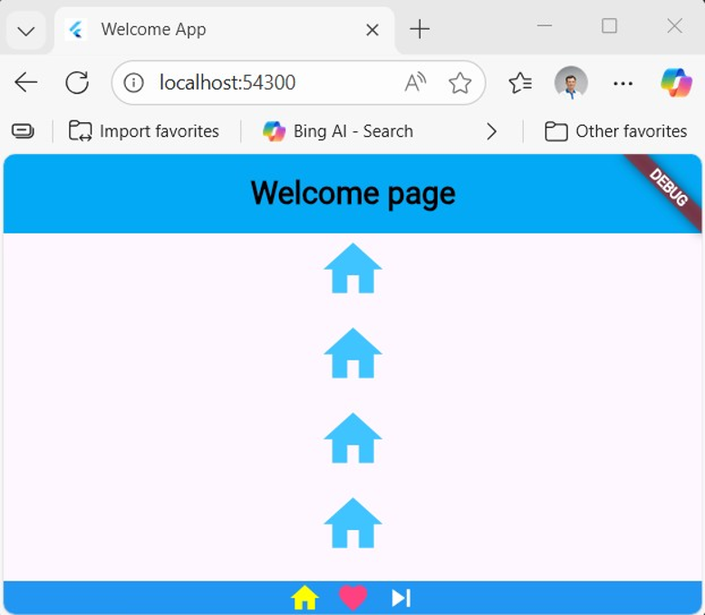

# Hello Flutter

A simple Flutter app that demonstrates a basic page layout. The home screen has
a centered column of four blue add icons and a blue bottom bar with home,
favorite, and skip icons.

## Requirements

- Flutter SDK
- A supported device, emulator, or desktop target

## Run the app

From the project directory, check your Flutter setup and start the app:

```shell
flutter doctor
flutter pub get
flutter run
```

To select a specific device, pass its device ID:

```shell
flutter run -d <device-id>
```

## Lab: Hello Flutter!

**Goal:** Build your first Flutter app and test it on an emulator or device.

### Steps

1. Run `flutter doctor` and resolve any reported setup issues.
2. Create a new Flutter project:

   ```shell
   flutter create hello_flutter
   cd hello_flutter
   ```

3. Replace the contents of `lib/main.dart` with this starter app:

   ```dart
   import 'package:flutter/material.dart';

   void main() => runApp(const MyApp());

   class MyApp extends StatelessWidget {
     const MyApp({super.key});

     @override
     Widget build(BuildContext context) {
       return MaterialApp(
         title: 'Hello Flutter',
         home: Scaffold(
           appBar: AppBar(title: const Text('Hello Flutter!')),
           body: const Center(
             child: Text('Welcome to Flutter App'),
           ),
         ),
       );
     }
   }
   ```

4. Run the app on an emulator or a real device.
5. Change the text color or add an icon to try hot reload.

### Homework

Override the `build()` method to create the UI shown below.



## Project structure

- `lib/main.dart` - app entry point and home screen
- `pubspec.yaml` - package metadata and dependencies
- `image.png` - homework target UI

For Flutter setup and documentation, see the
[Flutter documentation](https://docs.flutter.dev/).
